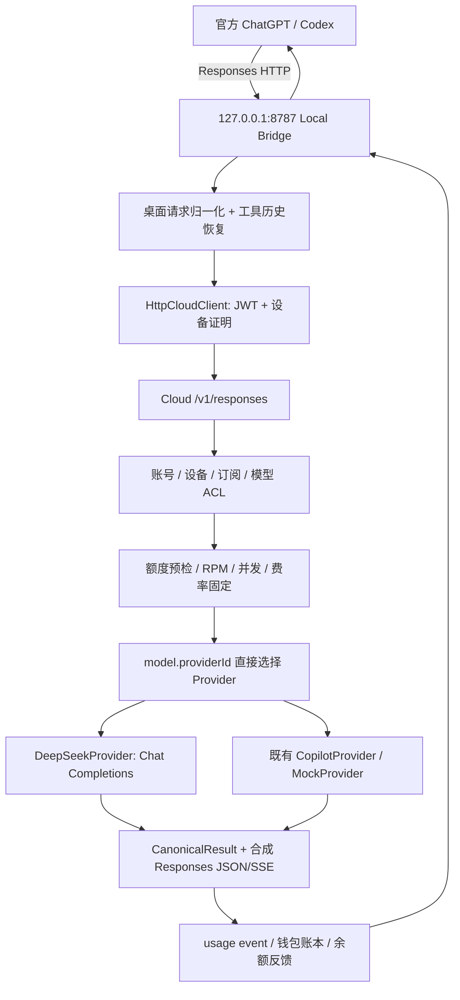

# CopilotBridge / CopilotBridgeCloud 当前架构审计（Phase 0）

审计日期：2026-10-11。范围：现有 Windows 客户端和 Cloud 源码、相关协议、迁移、历史调查文档及定向测试。此文件记录**当前实现**；后续方案见 [MIGRATION_PLAN.md](MIGRATION_PLAN.md)。

## 1. 基线与证据等级

| 项目 | 本地目录 | 审计基线 |
| --- | --- | --- |
| 客户端 | `H:\8_code\copilot-bridge-app` | `1fce4f2c234b4cab0c6517e706aa97c593ba497c`，package 0.2.7 |
| Cloud | `H:\8_code\CopilotBridgeCloud` | `9ca768557f9b6b6913a7e080b81d2ccf0b684017` |

两库开始审计时工作区干净。本轮没有修改业务代码、执行数据库迁移、重启官方客户端、抓取私人会话、调用付费模型或部署线上。没有对生产数据库、当前已安装官方客户端和 DeepSeek 官方最新能力进行重新验收。

- **源码确认**：当前路径/字段/策略确实存在；不等于线上已运行该版本。
- **本轮离线验证**：类型检查、fixture/模拟上游测试通过；不等于真实 Desktop E2E。
- **历史记录**：仓库记录曾做的实验；版本、模型、模式不同不能直接外推。
- **未知/待测**：官方客户端内部 harness、完整 wire 行为、当前账号上游能力必须通过受控真实请求确认。

## 2. 实际调用链

当前 Cloud **没有独立 Instance Router**，没有原生 Responses 透传路径。`CanonicalRequest/CanonicalResult` 是 Cloud 全部 Provider 的统一主路径。另有既有 LOCAL 模式：`BridgeManager` 启动 vendor Copilot proxy + SDK/runtime；它与 REMOTE Cloud 模式互斥使用 8787，不能把 LOCAL 的实验结果视作 Cloud 验收。

### 客户端与官方运行时边界

依据客户端 `electron/main.ts`、`gateway-profile-store.ts`、`bridge-manager.ts`：

- 当前有效 home 为 `CODEX_HOME` 或原 `.codex`，切换只修改 `config.toml` 模型连接配置，保存快照并合并恢复期间的非连接修改；会话存储沿用官方环境。
- Bridge Provider 使用 `wire_api="responses"`、本地 `/v1` endpoint、凭据 helper；不是免登录 OpenAI 官方云服务，而是平台账号认证后使用 Cloud 资源。
- 安装检测和官方客户端重启已有实现；不需要重新设计 Windows 环境变量/注销机制。共享存储不保证所有原账号历史可以在另一模型中继续执行。
- 本地网关绑定 loopback，验证 Bearer 和拒绝 Origin；云平台 token、设备证明与本地凭据分开。
- 官方客户端提供的工具定义，经协议转换交给模型；模型返回调用，由上游客户端执行，再回传结果。Cloud DeepSeek 适配器没有 shell/filesystem 工具执行器。
- LOCAL SDK 的 pending-tool 桥仍在 vendor 中。Cloud Copilot 适配器会拒绝带 tools 的请求，与 LOCAL Copilot Tool Bridge 能力不同。本轮保留两者，不扩建。

因此不能根据 Bridge 的 function_call 代码证明官方客户端内部具体如何规划、循环、授权或生成 Artifact。测试 harness 也是外部验收工具，不是产品 Agent。

## 3. 模型、资源和权限现状

依据 [schema.ts](packages/db/src/schema.ts)、[core.ts](apps/api/src/core.ts)、[admin.ts](apps/api/src/admin.ts)、[provider.ts](apps/api/src/provider.ts)：

| 实体/逻辑 | 当前职责 | 与目标的差距 |
| --- | --- | --- |
| `models` | publicId、展示名、能力布尔、上下文/输出限制；固定 providerId/providerModelId | 同时代表逻辑模型和具体后端绑定 |
| `providers` | code、名称、启用、baseUrl、timeout、config | 既代表 Provider 类型，也代表一套实际 API 连接 |
| `provider_credentials` | 每 Provider 一份 AES-GCM 管理密钥 | 可以继续复用，不需要第二套密钥表 |
| `provider_accounts/…credentials` | 用户所属 BYOS 账户/加密密钥 | 已有独立所有权和计费语义；不是自动资源池 |
| `plan_model_access/user_model_access` | 对 models.id 的套餐及用户 ALLOW/DENY | 应继续保留，逐步使模型只表示逻辑模型 |
| `allowedModels/requireEntitlement` | 模型与 Provider 启用 + 订阅 + ACL + 测试限制 + 额度 | 直接 join 单个 Provider，不检查候选实例集合 |
| `model_sessions` | user/device/thread 唯一；model/provider/session/state | 缺实例固定、协议模式和完整响应历史引用映射 |

管理员新增 DeepSeek 连接会创建 `DEEPSEEK_<12位随机HEX>` Provider。`connect-deepseek` 验证官方 `/models`，加密 key，启用连接并按目录创建模型。额外连接的 publicId 类似 `deepseek/<连接后缀>/<上游模型>`。因此用户现在能选择的是**带资源身份的模型条目**，并不是一个逻辑模型背后的多个实例。

创建目录条目不代表实际生成、工具、图片、思考已经探测成功：tools/streaming 设为 true，reasoning 设为 false，vision 由模型名 `deepseek-flash` 推定。现有 health 请求 `/models`，不是持续健康状态机；源码未发现用于池调度的 priority/weight、熔断、半开或健康 TTL。`usageWeight` 是旧计费权重，不能拿来当路由权重。

客户端仍有 `providerConnectionId`、BYOS 管理/选择路径与 `X-Provider-Connection-ID`，服务端会验证归属。目标“只选逻辑模型和真实思考模式”尚未完成；移除公共客户端资源选择应保留历史 BYOS 数据和兼容边界。

## 4. Responses 协议兼容现状

入口：Local 与 Cloud 当前主要都是 `GET /v1/models`、`POST /v1/responses`；Local 另有 health/bridge models。当前 Cloud Gateway 无通用 Chat Completions 客户端入口。仅靠路由名相同不能宣称 OpenAI 全协议兼容。

源码链：客户端 `desktop-protocol.ts → remote-bridge-server.ts → http-cloud-client.ts → contract.ts`；服务端 `packages/contract/src/schemas.ts → gateway.ts → provider.ts → deepseek-provider.ts`。

| 字段/行为 | 当前处理 | 缺口 |
| --- | --- | --- |
| model/input/stream/function tools | 两端 Zod 校验；Cloud 转 Canonical | 基础路径可复用 |
| instructions | 不在请求 schema | Zod 默认剥离，未送上游 |
| tool_choice / parallel_tool_calls | 不在 schema | 丢失用户/客户端约束 |
| reasoning | 接受对象，客户端可覆盖 effort | DeepSeek 实际忽略，固定 disabled |
| text/structured output/include/metadata | 不在 schema | 剥离；不能称结构化输出已支持 |
| previous_response_id | 不在 schema | 剥离；没有通用响应引用恢复 |
| unknown root fields | 不 passthrough | 无损同协议路径不成立 |
| developer message | Local 改成 system | 有语义转换，应显式记录 |
| additional_tools/namespace/custom tools | Local 提取、生成别名、custom 转 function，结果还原 | 有用但为有损适配；不支持的内建工具会被忽略 |
| reasoning / compaction input items | Local 直接删除 | 会损失历史；不能把避免校验失败当语义正确 |
| item_reference | Local 拒绝并要求新会话 | 尚未实现跨响应引用 |
| function_call_output 数组 | Local JSON 字符串化 | 多模态工具输出不再保留原结构 |
| image | message content 中 input_image URL 转 DeepSeek image_url | 没有完整能力探测/受控真实本轮验收 |
| input_file/audio/video | 无完整转换支持；未知 content part 会抛异常 | 应做能力拒绝及明确协议错误 |

### JSON 和 SSE

- Cloud 给输出重新赋 message/function ID，生成统一 `response.completed` 和 usage。
- DeepSeek 的 text delta 可渐进输出；工具 arguments delta 在适配器内部组装，最终一次性输出 function_call。没有完整 function arguments delta/done 事件映射。
- reasoning_content、refusal、structured output、finish_reason 导致的 incomplete 等未完整映射；当前生成响应主要为 completed/failed。
- 流建立时先发一个 message item；工具、消息结束事件在结果就绪后合成。对纯工具输出、索引及状态的一致性仍需专门验证。
- Local 改写 custom/namespaced tool events，且以较窄 OutputItemSchema 解析 done 项；未知 output item 可能无法通过，不能称透明 SSE 中继。
- Local 可读正文最多 10 MiB，Cloud Fastify bodyLimit 为 1 MiB；附件请求会在更早边界失败。此限额不应盲目增大，应先确认真实输入形式。
- 断连 AbortSignal 已有链路；上游缺少 usage 时有审核状态，但不是完整取消、背压、reader 清理及部分消费核算的证明。

## 5. 续接、长会话与已有错误

Local `RemoteBridgeServer` 使用 call_id → conversation 的 pending/history maps；工具输出可恢复完整历史，校验重复、篡改及跨活动会话。缓存账号隔离、safeStorage 加密，最多最近 8 个会话、24 小时过期、约 20 MiB 文件限制；不能等同永久会话存储。

无工具输出的请求会生成新的 Cloud thread UUID；有完整工具历史或已知 call ID 的请求才可找回关联。`session_id/conversation_id` 目前只用于诊断，`previous_response_id` 未参与关联。Cloud session 保存 1 小时；工具 continuation 免部分 RPM 的窗口为 5 分钟、最多 8 轮，且需历史指纹匹配。套餐 RPM 和并发检查仍适用。

这些是“过一会儿工具续接失败/429”的**可能代码原因**，不是对某次真实报错的最终归因。其他可能条件包括 cache 失效、只有 orphan output、调用混入另一活动会话、模式/模型改变或上游限流。必须沿 trace/request/thread/response/call ID 对齐实际请求才能定位。不能延长 TTL 或去掉归属校验来掩盖问题。

## 6. DeepSeek 与计费

### 当前适配能力（源码，不是官方最新能力承诺）

- 官方 `/models` 校验 key/发现目录；`/user/balance` 获取账号共享余额。
- `/chat/completions` 支持文本消息、function tools、多个调用、工具输出历史、text SSE、分段 arguments 重组、usage/cache token 读取。
- `thinking:{type:'disabled'}` 固定发送；reasoning token 计数虽读取，**思考能力没有实现**，更没有真实 normal/thinking/auto 配置。
- adapter 要求 prompt/completion token 计数为安全整数；截断流拒绝成功；原生成本保持 UNKNOWN，不把推算售价伪称实际成本。
- 目录可发现的模型与可计费模型不同：默认价格配置仅有 `deepseek-flash`、`deepseek-v4-pro`。其他目录模型可能因 `RATE_CARD_UNAVAILABLE` 失败。不要将需求示例 deepseek-chat/reasoner 强行替换当前模型。
- DeepSeek 非成功状态通常变成 `HTTP_nnn`，Gateway 多数归为 PROVIDER_UNAVAILABLE；上游 429/401/400 未形成完整类别。上游 402 单独提示管理账号余额不足。

当前官网价格/能力本轮未联网复核。`money-pricing.ts` 中数值是**代码配置基线**，上线前须附官方资料日期和实际目录/probe；这些值不能视作本审计提供的最新定价结论。

### 可复用的计费基础

依据 `core.ts/gateway.ts/money-policy.ts/money-pricing.ts/metering.ts/rating.ts/wallet.ts` 和现有 SQL 迁移：

- `10000 AI_POINT = ¥1`；PAYG/QUARTER、管理员 RMB 限额、倍率及费率版本已有实现。
- 每次请求重新查账号、设备、ACL/订阅/额度/RPM；moneyEnabled 路径可覆盖环境中的 SHADOW 为 ENFORCED。旧文档“始终未扣费”不能代表当前代码。
- 管理 DeepSeek 路径预检钱包/周期预算及上游共享余额（5 秒缓存），估算输入、限制 max_tokens，并通过 RUNNING usage record 预留预算。
- 请求固定 rateCardVersion；实际 usage 进入唯一 usage_event；钱包行锁、唯一幂等键、不可变账本及到期 lots 可复用。
- usage 返回点数、RMB、周期用量、余量、限制；Local settlement 回调重新拉取并广播客户端状态。
- UNPAID/METERING_ERROR/UNRATED 会阻止后续消费；中断且已观察文本但没有 usage 不能冒充零成本。

仍不能保证“绝不赔钱”：输入估算不是上游 tokenizer，上游账号可能被其他应用共享消费，余额快照不是账户级预留，多个平台用户没有共同上游预算锁，超时可能已有上游计费。实例池加入后还要区分客户售价与实例成本、固定实际执行实例，并记录尝试及部分 usage；不得通过切实例重试重复执行/扣费。

管理员余额来自账号共享 `/user/balance`，不是每模型独立剩余 token。各模型 usage 由本站 usage_records 汇总，不包含站外调用。

## 7. 日志与兼容证据

已有 Cloud request log：时间（logger）、请求 ID、方法、route、状态、耗时、user/device/model/provider；不记录 query/header/body/error message。Compose 配置每服务 json-file 10 MiB × 3。SSE 失败在 HTTP 200 后发生，普通 onSend/onResponse 不足以表达完整流终止原因。

已有 Local trace：desktop_received/request、cloud_request/headers/event/response、失败和结束，可关联 trace/thread/request、部分 session/conversation。10 MiB 当前文件加 4 个历史文件，总量约 50 MiB；正文单条上限 4 MiB。正文抓取由 capture.json 限时开启。

缺口：默认元数据没有完整 model/stream/reasoning/tool_choice/previous_response_id/call IDs/协议模式/实例/终止原因；开启正文时只屏蔽特定密钥字段和 sk 字符串，**文档、prompt、工具参数和结果仍可明文入日志**。超大 entry 的降级路径也需复核脱敏。当前是请求诊断，不是完整所有官方网络请求的抓包，不涵盖 WebSocket/官方外站网络。

应扩展已有 trace/logger，生成匿名 fixture corpus，不增加全局 HTTPS MITM。原始授权捕获与能入 Git 的脱敏 fixture 必须分开，并明确内容最小化、保留期限和删除机制。

## 8. 历史文档与当前代码的冲突

| 文档 | 应如何使用 |
| --- | --- |
| 客户端 README、system/model-routing/cloud-integration-foundation、早期 handoff | 记录旧 LOCAL/CODEX_HOME 注销和 Cloud 接入阶段；当前共享 config 切换/0.2.7 以源码为准 |
| chatgpt-runtime.md | 2026-09-21 Store activation 与独立 app-server 实验；不能证明当前 Desktop harness 内部行为 |
| attachment-artifact-investigation.md / attachment-runtime-diff.md | 旧 Copilot SDK/runtime 调查；后者否定提示泄露 marker 的 TXT PASS；不是 DeepSeek Cloud 文件验收 |
| Cloud architecture-v2/database-v2/migration-v2/billing-v2/api-v2 | 有用的领域/不变量和历史上线记录；包含 SHADOW、空钱包、旧迁移范围、协议阶段等过期叙述 |
| CONTRACT_VERSION.json | 当前仓库声明 Domain 2.4.0，Gateway 1.0.0 冻结；实际窄 schema 与完整 Responses 需求冲突，后续必须显式兼容版本评审 |

旧文档“Provider router”图不等于当前具备资源池调度。历史本地文件 workflow 和 PNG SDK PASS 不等于官方 Desktop → Cloud → 当前 DeepSeek 的文件理解/Artifact UI PASS。

## 9. 本轮 Tests

| 命令 | 结果 | 能证明的范围 |
| --- | --- | --- |
| 客户端 `npm run typecheck` | PASS | renderer/electron 当前源码类型检查；tsc 生成的 dist 被下面测试使用 |
| `node --test test/desktop-gateway.test.mjs test/remote-bridge-server.test.mjs test/cloud-history-recovery.test.mjs` | 15/15 PASS | normalization、鉴权、settlement 回调、SSE/call ownership、完整历史和加密缓存恢复、日志轮转/过期 |
| API vitest：deepseek-provider、tool-continuation、rating、request-log | 12/12 PASS | 模拟上游 delta/call/usage、截断拒绝、续接、固定点数计算、日志不泄密 |
| API vitest：money-policy | 4/4 PASS | RMB 换算、倍率、时段、未定价模型拒绝 |

第一次 API 命令还包含不存在的 `money-pricing.test.ts`，它没有执行；随后单独执行实际 `money-policy.test.ts`，结果如上。Fastify 有现存 disableRequestLogging 弃用警告，测试未失败。未运行数据库集成/迁移测试、真实付费 DeepSeek 或官方 Desktop E2E。

## 10. 结论

可以继续演进当前项目：平台鉴权、设备证明、ACL、用户/RMB限制、账本、管理站、桌面配置切换、更新发布、工具历史校验和基础 SSE 均有复用价值。

真正需要改变的是：拆开模型身份与资源绑定，建立实例选择与续接固定；扩展 Responses 能力边界与事件表达；实现 DeepSeek 真实思考及工具语义；让同协议路径绕开 Canonical；补齐脱敏证据与错误分类。无需重写客户端聊天 UI、Agent harness、工具执行器或财务领域。
